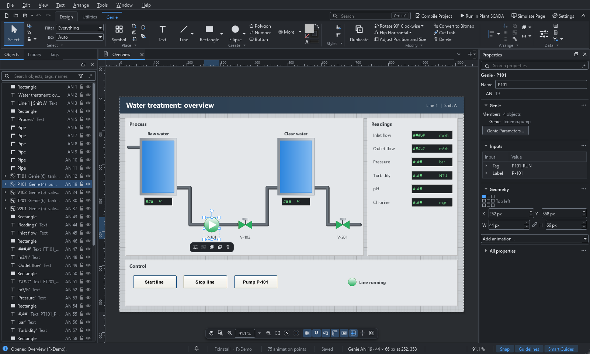
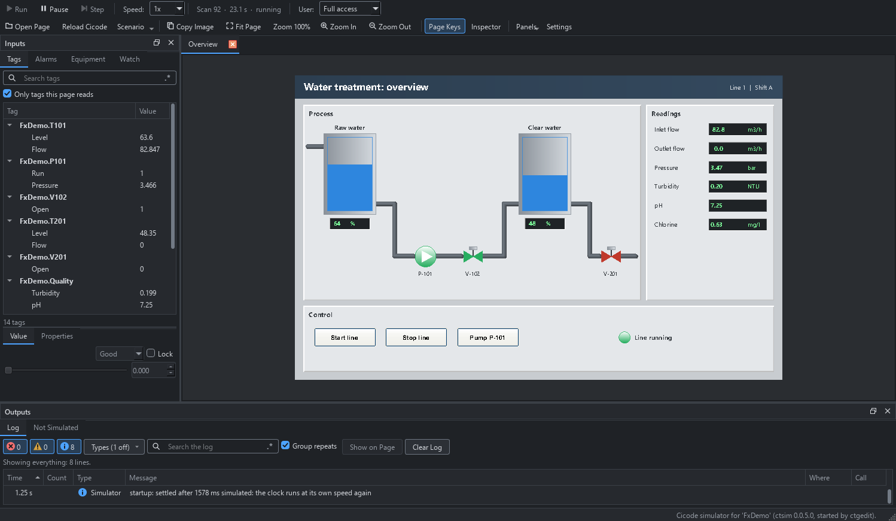
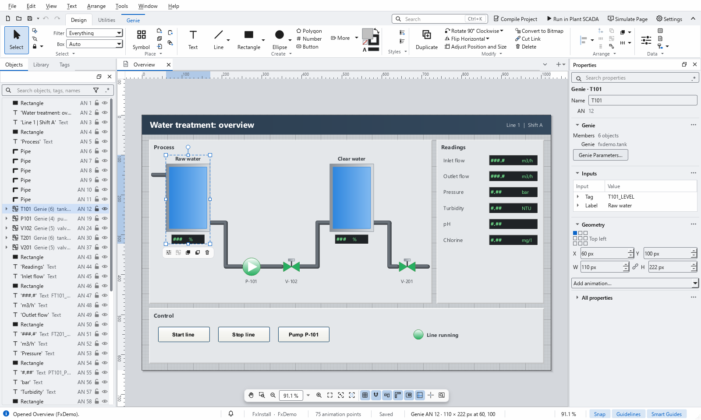

# ctgedit

An editor for AVEVA Plant SCADA (Citect) graphics pages. It opens and saves the same `.ctg`
pages and libraries as the Graphics Builder, so your pages still compile, run and open in
AVEVA's own tools.



## Features

- Pages, templates, symbols, genies, super genies and composite genies
- Tabbed documents, a ribbon, dockable panels and a light or dark theme
- Command palette and search (Ctrl+K)
- Undo for every edit, and earlier versions of each page
- Find and replace across a whole project
- Simulate a page: run its Cicode with simulated tags, no runtime needed
  (uses the [ctsim](https://github.com/MSkjel/ctsim) engine)
- A built-in manual (F1)



<details>
<summary>Light theme</summary>



</details>

## Install

Download `ctgedit-<version>-setup.exe` from
[Releases](https://github.com/MSkjel/ctgedit/releases) and run it. It needs Windows 10 or 11
(64-bit) and no administrator rights. Python and Qt are bundled.

By default it installs for the current user in `%LOCALAPPDATA%\Programs\ctgedit`. The installer
can also install for all users and make ctgedit the default program for `.ctg` files.

ctgedit checks for new versions when it starts. You can also use Help > Check for Updates.
Uninstalling keeps your settings and logs.

## Usage

Start ctgedit from the Start menu or double-click a page. With no page it reopens your last
session. A page opened while ctgedit is running goes to the open window.

```
ctgedit [page.ctg ...]            open pages, in the running editor if there is one
ctgedit --new-instance [...]      start a separate editor
ctgedit --version                 print the version and commit
ctgedit --smoke-test page.ctg ... [--report result.json]
                                  open, edit, save and close copies of pages, without a window
```

To report a bug, use Help > Copy Diagnostics and paste the result into an issue. The logs are in
`%LOCALAPPDATA%\ctgedit\logs` (Help > Open Log Folder).

## Building from source

You need Python 3.14 and the .NET SDK.

```powershell
git clone --recursive https://github.com/MSkjel/ctgedit.git
cd ctgedit
py -V:3.14 -m venv .venv
.\.venv\Scripts\python -m pip install -r requirements.txt
dotnet build external\cicode-sim\engine\src\ctsim\ctsim.csproj -c Release -f net48
.\.venv\Scripts\python -m ctgedit.app
```

If you cloned without `--recursive`, run `git submodule update --init`. The ctsim engine is a
submodule pinned to one commit, and Dependabot opens a pull request when ctsim moves on.

### Tests

```powershell
.\.venv\Scripts\python tools\run_tests.py test-log.txt --workers 2
```

The default suite runs against a small fake install in `tests/fixtures/FxInstall` and never
touches a real Plant SCADA install. `tests_corpus/` and `tests_live/` need a real install and
only run when asked for (`--suite corpus|live|all`). CI also checks formatting and lint with
ruff 0.17.6 (`ruff format .`, `ruff check .`).

The pictures in this README come from `tools/screenshots.py`, which opens the fake install's
FxDemo project and takes them. CI runs it on every push to main and puts the pictures on the
`screens` branch.

### Releases

```powershell
.\.venv\Scripts\python -m pip install -r packaging\requirements-build.txt
.\.venv\Scripts\python tools\release_check.py
powershell -ExecutionPolicy Bypass -File packaging\build.ps1
```

The installer is built with Inno Setup 6.3 or later. The version is the newest `vX.Y.Z` tag;
a build of a later commit takes the next patch number, and a checkout without tags is 0.0.0.
To publish a release, push a `vX.Y.Z` tag on a commit of main. The release workflow checks
that CI passed on that commit (waiting for it if it is still running), builds the installer
and attaches it to a GitHub release.

### Layout

```
ctgedit/
  format/    the .ctg and library file formats (standard library only)
  model/     the document model
  infra/     data folder, logs, caches, backups, page versions, updates
  io/        reading files into the model, project tables
  doc/       document edits by topic (EditableDocument is in editing.py)
  features/  Find and Replace, Check Page, workspace checks, symbol sets
  workers/   helper processes for batch work on closed pages
  render/    drawing pages with Qt
  sim/       the ctsim client
  backend/   Plant SCADA's own programs: compiler, runtime, Graphics Builder
  diag/      what opening a page found
  ui/        the application window, panels, dialogs and settings
  help/      the built-in manual
docs/        architecture, file formats, testing, UI guide, simulator
tools/       scripts for checks, fixtures and releases (see tools/README.md)
tests/       the default test suite (tests_corpus/ and tests_live/ are opt-in)
external/    the ctsim engine (submodule)
packaging/   PyInstaller spec, installer script and build script
```

[docs/ARCHITECTURE.md](docs/ARCHITECTURE.md) explains how the parts fit together,
[docs/TESTING.md](docs/TESTING.md) covers the test suites, and
[CONTRIBUTING.md](CONTRIBUTING.md) lists what to run before a pull request.

## Known limitations

- Web Content objects show as a placeholder box, as they do in the Graphics Builder.
- ActiveX controls are drawn from a snapshot, so they don't update while you edit.
- Industrial Graphics symbols (`.vedef`) aren't drawn.
- The installer isn't code-signed, so Windows SmartScreen warns the first time you run it.

## License

Copyright (C) 2026 MSkjel

This program is free software: you can redistribute it and/or modify it under the terms of the
GNU General Public License as published by the Free Software Foundation, either version 3 of the
License, or (at your option) any later version. See [LICENSE](LICENSE).

AVEVA, Plant SCADA and Citect are trademarks of their owners. This project is not affiliated with
or endorsed by AVEVA.
